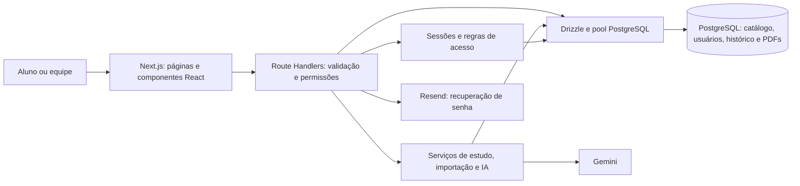

# Auditoria de arquitetura — Aprova UNIVESP

Data: 13 de outubro de 2026. Referência inicial do código: `c77dd86`.

## Parecer

O projeto tem uma base tecnológica atual e uma arquitetura adequada para um MVP profissional de estudos: Next.js App Router, React, TypeScript estrito, PostgreSQL, Drizzle e implantação na Vercel. A evolução recomendada é manter um monólito modular e melhorar suas fronteiras internas, segurança de dependências, testes de interface e operação.

A maturidade observada é de produto funcional em evolução. A revisão encontrou defeitos concretos e lacunas que precisam ser tratados antes de ampliar o uso. Build e testes aprovados não comprovam capacidade para uma quantidade determinada de alunos nem disponibilidade em produção.

O arquivo anexado descreve outro produto: uma demonstração de empregabilidade com Vite, dados simulados e sem backend. Seus critérios de organização e experiência foram considerados, mas suas exigências de stack e funcionalidades não se aplicam ao Aprova UNIVESP. A aplicação atual precisa de autenticação e persistência reais.

## Escopo e evidências

Foram inventariados 106 arquivos TypeScript, TSX e CSS em `src`, com aproximadamente 8.125 linhas, e 52 métodos HTTP nas APIs. Foram revisados os fluxos de cadastro, sessões, permissões, aprovação, materiais/PDFs, questões, provas, revisão, perfil, suporte, IA, migrações, configuração, testes e implantação. O inventário e as buscas abrangem o código principal; a inspeção aprofundada se concentra nesses fluxos e suas dependências.

Os projetos auxiliares de vídeo e apresentação não foram objeto de revisão aprofundada. Não houve alteração funcional, migração de banco ou publicação durante esta auditoria. A execução de `next build` atualizou o arquivo gerado `next-env.d.ts`.

| Verificação | Resultado nesta revisão |
| --- | --- |
| `npm run lint` | Passou, sem avisos reportados |
| `npm test` | 61 testes passaram |
| `npm run build` | Passou, incluindo compilação e verificação TypeScript |
| `npm audit --omit=dev --json` | 3 dependências classificadas como altas; nenhuma crítica |
| `npm audit --json` | 14 dependências sinalizadas: 10 altas e 4 moderadas; nenhuma crítica |
| Reprodução do limite de PDF | Corpo de 3 MiB passou no proxy de criação e recebeu 413 no proxy de anexação |
| Contraste de cores do código | `#8490a7` sobre branco: aproximadamente 3,22:1 |
| `npm run doctor` | Banco local indisponível: `ECONNREFUSED` |
| Integração com PostgreSQL real, navegação visual e carga | Não validadas nesta execução |

O primeiro acesso ao registro npm apresentou falha de certificado. A auditoria foi concluída usando o repositório de certificados do sistema, com `NODE_USE_SYSTEM_CA=1`, mantendo a validação TLS. O JSON da auditoria completa está em `artifacts/auditoria-2026/npm-audit.json`, uma pasta ignorada pelo Git.

O diagnóstico local identificou ausência de configuração do Resend. Isso descreve o ambiente local e não permite concluir que produção tenha a mesma configuração. Nenhuma credencial foi incluída neste relatório.

## Arquitetura observada



| Área | Avaliação |
| --- | --- |
| Stack | Atual e adequada; as versões instaladas precisam de manutenção de segurança |
| Organização | Clara em `app`, `components`, `lib` e `db`; os módulos de negócio ainda estão dispersos |
| Autorização | Boa base: verificações no servidor e funções diferentes para aluno, assistente e administrador |
| Integridade de dados | Boa base: transações, restrições, snapshots e idempotência de tentativas |
| Interface | Componentes e identidade visual compartilhados; acessibilidade e testes no navegador precisam evoluir |
| IA | Validação de saída e revisão humana previstas; orçamento de tempo e controle de custos precisam melhorar |
| Operação | CI e ferramentas de manutenção existem; execução real, alertas e recuperação precisam ser demonstrados |
| Escala | Plausível para um catálogo inicial; capacidade e custos ainda não foram medidos |

Next.js 16 está na linha Active LTS na [política oficial de suporte](https://nextjs.org/support-policy). Node 22 permanece LTS na [tabela oficial do Node.js](https://nodejs.org/en/about/previous-releases). O uso de uma stack recente não substitui atualização de patches, testes e monitoramento.

## Pontos fortes comprovados no código

- Sessões com token aleatório de 32 bytes, hash no banco e cookie `HttpOnly`, `SameSite=Strict` e `Secure` em produção: `src/lib/auth.ts`.
- Acesso ao conteúdo e permissões administrativas verificados nas APIs, incluindo restrições de assistentes. Ocultar controles na interface é complementado por proteção no servidor.
- Cadastro e pré-autorização restritos a `@aluno.univesp.br`, com validação no servidor: `src/lib/constants.ts`, `src/lib/access.ts` e API de cadastro.
- Nota da prova calculada no servidor; respostas duplicadas e questões de outras matérias são rejeitadas. Tentativas têm chave de idempotência e preservam snapshots: `src/app/api/attempts/route.ts`.
- Progresso atualizado por upsert atômico; migrações com transações, checksums e bloqueio para impedir execução concorrente.
- PDFs servidos por rota autenticada, com verificações de arquivamento e cache privado. Binários ficam em tabela separada e não são carregados nas listagens.
- IA com validação de alternativas, referências ao conteúdo, limites de entrada e revisão antes de publicação. Isso reduz erros estruturais, sem garantir correção pedagógica.
- CI configurado com PostgreSQL isolado, build e testes de APIs. Scripts de backup, restauração e limpeza existem.

## Achados prioritários

### P1 — Atualizar dependências com alertas de segurança

**Evidência:** `next` instalado em 16.3.6 e `source-map-js` em 1.2.1. A auditoria de produção sinalizou `next`, `postcss` e `source-map-js`; parte dos alertas é propagada pela mesma cadeia de dependências. O total não representa três vulnerabilidades independentes ou três explorações demonstradas.

Os intervalos informados pelo npm para os avisos do Next terminam em 16.3.8. O registro npm confirmou que essa versão existe e que a versão estável indicada por `latest` é 16.4.0 nesta consulta. Para `source-map-js`, a correção indicada é 1.2.2, também registrada pelo [mantenedor](https://github.com/7rulnik/source-map-js/releases/tag/v1.2.2).

**Aplicabilidade:** o [aviso oficial de SSRF do Next](https://github.com/vercel/next.js/security/advisories/GHSA-cjq9-62q9-8jv4) exige URLs remotas permitidas em `images.remotePatterns`; essa configuração não foi encontrada no projeto. O aviso de Draft Mode exige recursos de cache e prévia que também não foram encontrados. Os alertas continuam exigindo manutenção, mas não comprovam que esses ataques funcionem nesta aplicação.

**Ação:** atualizar Next e a configuração ESLint compatível, revisar as dependências transitivas e atualizar o lockfile. Validar os avisos de ferramentas de desenvolvimento separadamente. Evitar aplicar `npm audit fix --force` sem revisar a resolução.

**Aceite:** auditoria sem alertas relevantes pendentes, ou exceções documentadas com aplicabilidade demonstrada, e testes/build aprovados após a atualização.

### P1 — Anexação de PDF aceita na tela e bloqueada pelo proxy

**Evidência:** `src/proxy.ts:9` concede o limite especial apenas ao caminho exato `/api/materials`. `/api/materials/:id/pdf` recebe o limite geral de 2 MiB, embora a seleção de arquivos e a rota de anexação aceitem até 4 MiB.

**Reprodução:** o mesmo corpo declarado de 3 MiB produziu passagem pelo proxy no endpoint de criação e HTTP 413 no endpoint de anexação. A reprodução executou a função do proxy com respostas Next simuladas; não dependeu de banco ou de uma publicação.

**Impacto:** alunos e equipe podem selecionar um arquivo válido e falhar ao anexá-lo a um material existente.

**Ação:** centralizar os limites e reconhecer ambos os caminhos de upload, reservando margem para multipart. O limite de corpo da hospedagem também precisa ser respeitado; a [documentação da Vercel](https://vercel.com/docs/functions/limitations) informa 4,5 MB para payloads de Functions.

**Aceite:** criação e anexação funcionam com PDFs reais próximos ao limite; arquivos acima dele são recusados com a mesma regra e mensagem. Testar passando pelo proxy, não apenas chamando o handler.

### P1 — O prazo total da IA pode superar o limite da rota

**Evidência:** `src/app/api/parse/route.ts:8` e a geração de materiais declaram 120 segundos. Em `src/lib/ai.ts:194`, a organização por IA recebe até 105 segundos; depois `importQuestions` chama `completeQuestionAnswers`, que cria outro prazo de 105 segundos em `src/lib/ai.ts:222`.

**Impacto:** etapas sequenciais lentas podem continuar tentando trabalhar além dos 120 segundos configurados. O resultado pode ser encerramento pela hospedagem após chamadas já efetuadas ao provedor. Trata-se de risco identificado no fluxo; não foi provocado um timeout real pago.

**Ação:** propagar um único deadline/AbortSignal por toda a operação e deixar margem para autenticação, banco e resposta. Se o processamento precisar ser mais longo, usar uma tarefa persistente com status consultável e retomada.

**Aceite:** simular lentidão nas diferentes etapas e comprovar que a operação encerra antes do limite, com erro controlado e sem chamadas posteriores ao cancelamento.

### P2 — Gestão da própria conta depende da aprovação para estudar

**Evidência:** GET e DELETE de `src/app/api/account/route.ts:11` e `:28` usam `requireUser`, que exige aprovação. O layout de `/app` também redireciona contas pendentes ou recusadas para a espera.

**Impacto:** alguém que já forneceu nome, e-mail, curso e WhatsApp não consegue exportar ou excluir a própria conta pelo fluxo do produto enquanto aguarda aprovação ou teve acesso recusado.

**Ação:** separar a autorização para administrar a própria conta da autorização para estudar, usando o guard de conta autenticada e uma tela acessível na espera. Preservar confirmação de senha e proteção do último administrador. Definir um procedimento de atendimento para contas bloqueadas.

**Aceite:** conta pendente pode gerir seus dados, mas continua impedida de acessar conteúdo, provas e funções administrativas. Este é um achado funcional, não uma conclusão jurídica de conformidade.

### P2 — O total de provas do painel para de crescer em 100

**Evidência:** o painel carrega `/api/attempts` em `src/app/app/page.tsx:33`. A API retorna uma página com limite padrão 100. O indicador “Provas feitas” usa `attempts.length` em `src/app/app/page.tsx:96`.

**Impacto:** uma pessoa com 101 ou mais provas vê um total incompleto. A média já é identificada como recente, e o histórico informa que seus indicadores se referem à página; o problema confirmado é o total do painel.

**Ação:** retornar estatísticas agregadas calculadas no banco, mantendo a lista recente paginada.

**Aceite:** para 150 provas, o total é 150 e o gráfico continua usando somente a janela recente planejada.

### P2 — Textos secundários têm contraste insuficiente

**Evidência:** `src/app/globals.css:17` define `--color-muted: #8490a7`. Sobre cartões brancos, a relação calculada é aproximadamente 3,22:1. O token é usado em textos pequenos, inclusive indicadores do painel.

**Impacto:** textos secundários ficam difíceis de ler. A [WCAG 2.2](https://www.w3.org/WAI/WCAG22/Understanding/contrast-minimum.html) estabelece 4,5:1 para texto normal; o limiar menor se aplica a texto grande e situações específicas.

**Ação:** escurecer os tokens de texto e verificar as combinações reais de fundos. Revisar também links contendo botões, presentes por exemplo no estado vazio do histórico, e preferência por movimento reduzido.

**Aceite:** verificação automatizada e manual de contraste, teclado e foco. Não foi realizada certificação completa de acessibilidade ou inspeção visual nesta sessão.

## Evolução arquitetural e operacional

| Prioridade | Evidência ou limitação | Evolução recomendada |
| --- | --- | --- |
| P2 | `scripts/e2e.mjs` inicia o servidor e executa testes de APIs; não automatiza navegador | Adicionar testes de navegador para cadastro, aprovação, função de assistente, seleção/anexação de PDF e prova. Manter os testes de API existentes |
| P2 | `scripts/doctor.mjs` só verifica tabela de migrações e `email_verified_at` | Verificar migrações esperadas, `is_assistant` e `material_files`, evitando diagnóstico positivo para esquema incompleto |
| P2 | Limites globais de login e cadastro dividem a cota entre todos; falhas de senha limitadas por e-mail | Acrescentar proteção por origem confiável e controles de abuso, preservando a cota global como proteção adicional |
| P2 | Senha mínima de 8 caracteres e autenticação própria sem MFA | Rever política de senhas e priorizar MFA para o administrador. A [OWASP](https://cheatsheetseries.owasp.org/cheatsheets/Authentication_Cheat_Sheet.html) recomenda maior comprimento quando não há MFA |
| P2 | Logs de erros e auditoria existem, mas não demonstram alertas de disponibilidade, latência ou recuperação | Definir indicadores, alertas, responsável e procedimento de incidentes; comprovar agendamento e restauração de backups |
| P2 | Uso de IA registrado em JSON no `target_id` da auditoria, sem usuário atribuído nesses eventos | Acrescentar atribuição, orçamento de chamadas/tokens e, quando necessário, tabela própria de eventos de IA |
| P3 | Materiais e prova têm aproximadamente 543 e 540 linhas, com UI e múltiplos fluxos no mesmo arquivo | Extrair hooks e serviços por funcionalidade; manter componentes de página como composição |
| P3 | PDFs armazenados em `bytea` e servidos pelo aplicativo | É uma solução viável para catálogo pequeno. Medir armazenamento, backups e transferência; planejar object storage privado e URLs autorizadas quando o volume justificar |
| P3 | Questões aleatórias usam `ORDER BY random()`, paginação usa offset e exportação reúne todo o histórico | Medir com dados representativos; avaliar paginação por cursor, amostragem e exportação assíncrona quando houver gargalo demonstrado |
| P3 | Auth consulta sessão/usuário e depois administrador; vários dados de tela são carregados após montagem | Avaliar deduplicação por requisição, DTOs explícitos e dados iniciais no servidor, sem cache compartilhado de informações privadas |
| P3 | Documentação de implantação orienta não migrar no build, mas `scripts/vercel-build.mjs` migra em produção | Unificar a política documentada e executável; manter migrações compatíveis com a versão anterior e previews em banco separado |

A [documentação de autenticação do Next.js](https://nextjs.org/docs/app/guides/authentication) recomenda centralizar acesso e autorização próximos dos dados. O projeto já tem guards reutilizáveis; o próximo passo é separar também regras de negócio e consultas por funcionalidade.

Uma organização possível, adotada gradualmente:

```text
src/
  app/                         # rotas e composição de páginas
  components/                  # componentes compartilhados
  features/
    access/                    # aprovação e permissões
    materials/                 # texto, PDF e publicação
    questions/                 # importação e edição
    study/                     # provas, histórico e revisão
  server/
    services/                  # operações de negócio
    repositories/              # consultas e DTOs
  db/                          # esquema e conexão
  lib/                         # utilitários compartilhados
```

Evitar criar camadas apenas por convenção. Extrair primeiro os fluxos com duplicação, regras importantes ou dificuldade de teste. React Router, Vite, Styled Components e um provedor de autenticação diferente devem ser decisões baseadas em necessidade, não requisitos importados do anexo de outro projeto.

## Decisões de produto que precisam ficar explícitas

- O cadastro institucional verifica o domínio, não a posse da caixa de e-mail nem o vínculo da pessoa com a universidade. Mantendo a decisão de dispensar confirmação por e-mail, a aprovação e a lista de pré-autorização precisam de um procedimento confiável de conferência.
- Os simulados devolvem gabaritos ao navegador. Isso é compatível com treino e revisão. Se houver avaliação formal, será necessário outro fluxo, com seleção de questões persistida e respostas divulgadas apenas no momento permitido.
- Questões produzidas por IA devem passar por revisão pedagógica; validação estrutural, pesquisa e trecho de origem não provam correção da resposta.

## Ordem recomendada de trabalho

1. Atualizar e validar dependências, corrigir o limite de anexação e unificar o deadline da IA.
2. Corrigir total de provas, acesso à gestão da própria conta e contraste de textos.
3. Criar testes de navegador e de fronteiras: proxy, arquivos próximos ao limite e IA lenta.
4. Validar ambiente real: esquema atual, envio de recuperação, banco de preview, backups, restauração e alertas.
5. Refatorar os módulos maiores gradualmente e medir carga/custos antes de escolher mudanças de infraestrutura.

O critério de prontidão deve ser o fluxo real funcionando com permissões corretas, recuperação comprovada e limites conhecidos. A aplicação tem uma base aproveitável para chegar a esse nível; esta auditoria não demonstra que produção já o atingiu.
